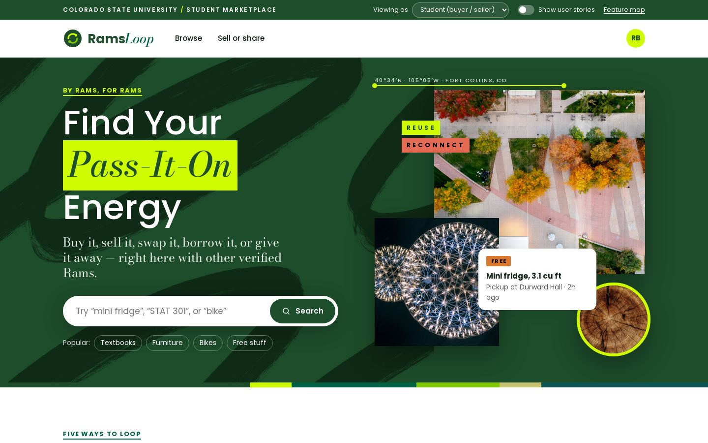
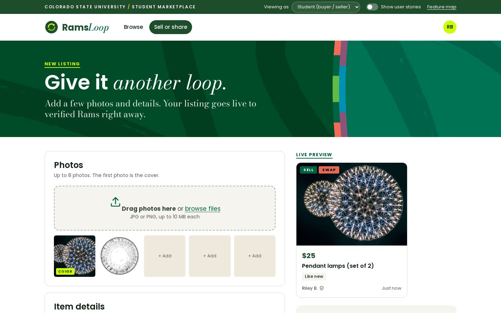
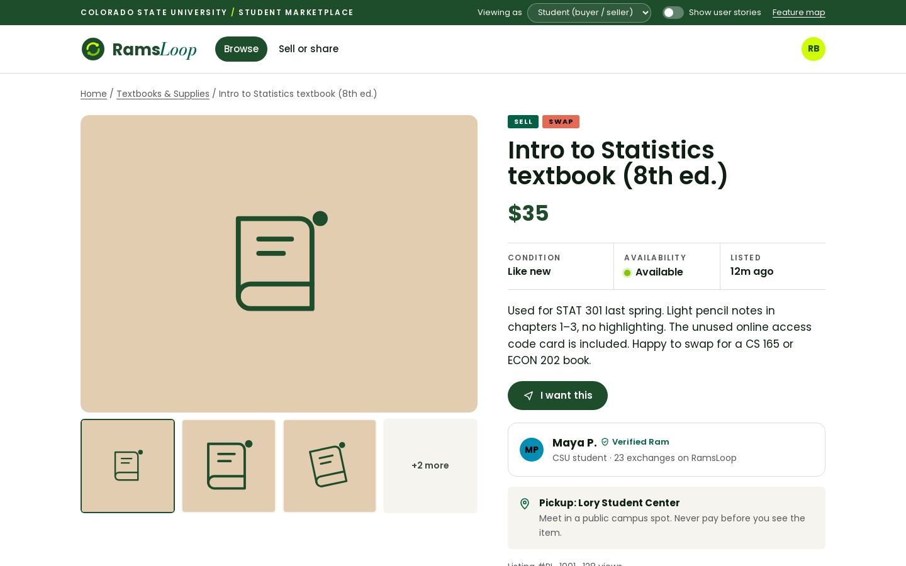
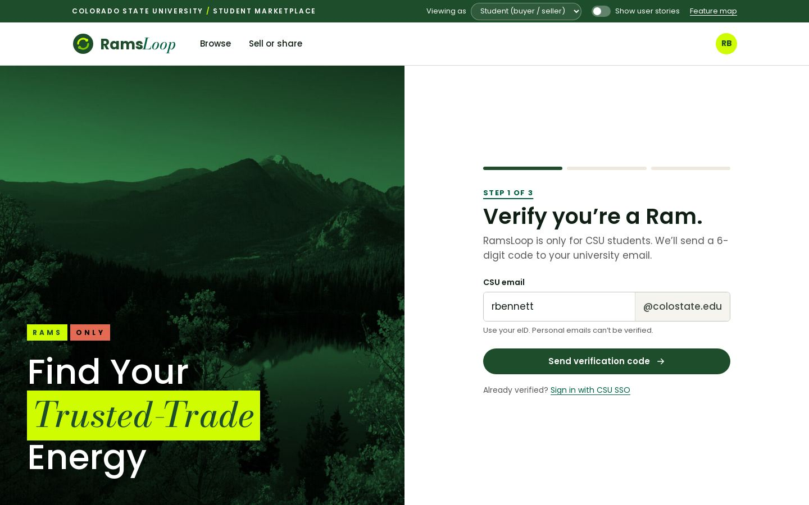
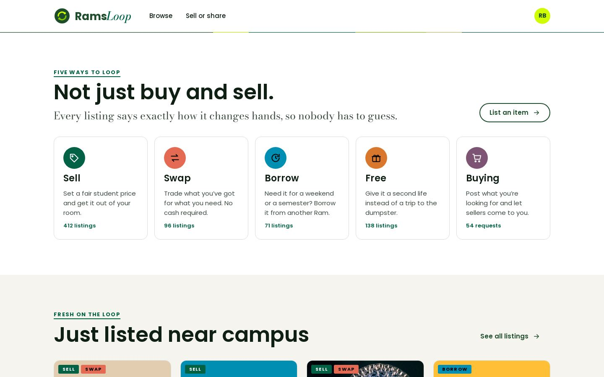
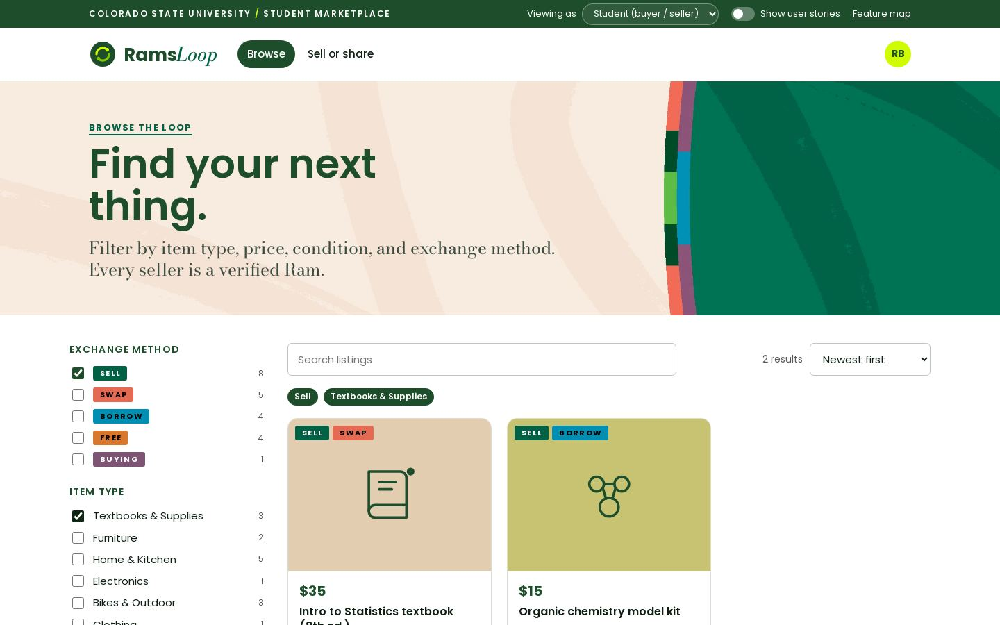
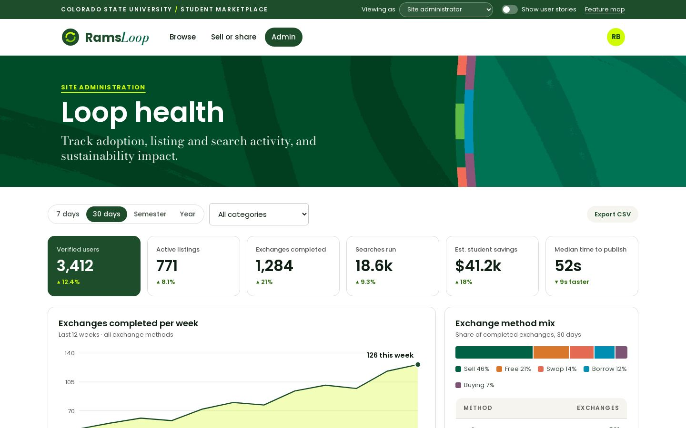
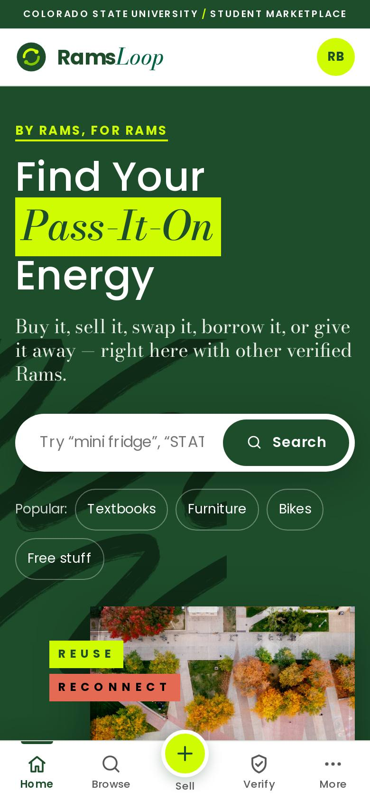
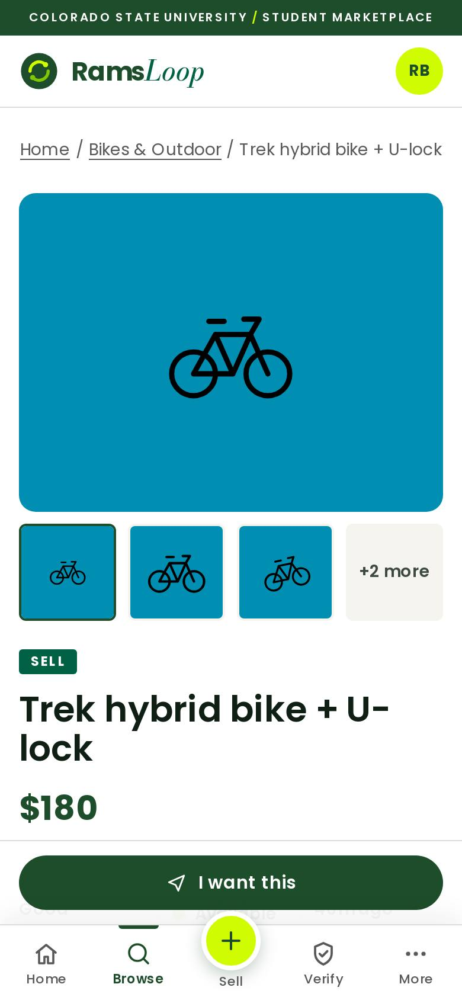
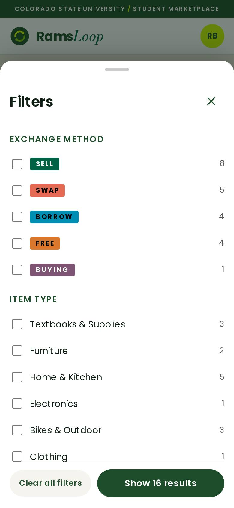

<p align="center">
  
</p>

<h1 align="center">RamsLoop</h1>

<p align="center">
  <strong>Buy, sell, swap, borrow, or give it away, with other verified Rams.</strong><br>
  A clickable UI mockup of a student-only marketplace for Colorado State University.<br>
  CIS 675 · Project Proposal, Team 1
</p>

<p align="center">
  <a href="https://jwelch00.github.io/Ramsloop/"><strong>Open the live demo →</strong></a>
  &nbsp;·&nbsp;
  <a href="https://jwelch00.github.io/Ramsloop/#/stories">Feature map</a>
  &nbsp;·&nbsp;
  <a href="https://github.com/jwelch00/Ramsloop/tree/full-version">Full 17-story version</a>
</p>



## What it is

RamsLoop is a campus marketplace where only people with a CSU email can get in.
Every listing says exactly how the item changes hands: **sell, swap, borrow, free,** or **buying** (a request).

This repo is a front-end mockup, built to show the screens and flows from our proposal.
It runs entirely in the browser on sample data. There is no backend, so nothing you type is saved or sent anywhere.

## The six user stories

The mockup is scoped to the six highest-priority stories from the proposal.

| Priority | Story | Theme | As a… | Where to see it |
|:-:|---|---|---|---|
| 1 | **US 9** · Create and publish listing | Listing & Exchange Management | Seller: create and publish a listing with photos, a description, condition, price, and exchange method so buyers can discover and evaluate my item. | [Sell or share](https://jwelch00.github.io/Ramsloop/#/sell) |
| 2 | **US 6** · Item details | Listing & Exchange Management | Buyer: view item photos, descriptions, conditions, price, and availability so I can make an informed decision. | [Listing detail](https://jwelch00.github.io/Ramsloop/#/item/1) |
| 3 | **US 1** · CSU affiliation verification | Trusted CSU Community | User: verify my CSU affiliation with my university email so I can use a trusted, student-only marketplace. | [Verify account](https://jwelch00.github.io/Ramsloop/#/verify) |
| 4 | **US 11** · Select exchange method | Listing & Exchange Management | User: mark a listing as buy, sell, swap, borrow, or free so other users understand the proposed exchange. | Sell form, plus the tags on every listing |
| 5 | **US 5** · Search and filter listings | Item Discovery | Buyer: search and filter listings by item type, price, condition, and exchange method so I can find suitable items quickly. | [Browse](https://jwelch00.github.io/Ramsloop/#/browse) |
| 6 | **US 17** · Site performance dashboard | Platform Administration | Site administrator: access performance indicators to monitor the health of the site. | [Admin dashboard](https://jwelch00.github.io/Ramsloop/#/admin) |

## Screenshots

<table>
  <tr>
    <td width="50%"><br><sub><b>US 9</b> · Create and publish a listing, with a live preview of the card</sub></td>
    <td width="50%"><br><sub><b>US 6</b> · Photos, description, condition, price, and availability</sub></td>
  </tr>
  <tr>
    <td><br><sub><b>US 1</b> · Verify with a @colostate.edu email and a 6-digit code</sub></td>
    <td><br><sub><b>US 11</b> · Five exchange methods, tagged on every listing</sub></td>
  </tr>
  <tr>
    <td><br><sub><b>US 5</b> · Filter by exchange method, item type, price, and condition</sub></td>
    <td><br><sub><b>US 17</b> · Performance indicators for site administrators</sub></td>
  </tr>
</table>

It also works on phones, with a bottom tab bar and slide-up filters:

<p align="center">
  
  &nbsp;
  
  &nbsp;
  
</p>

## Demo tips

- **Show user stories:** flip the switch in the top bar. A yellow tag appears beside each feature with the story it covers.
- **Viewing as:** switch to *Site administrator* to see the **Admin** tab (US 17).
- **Feature map:** the link in the top bar lists all six stories and jumps to each screen.

## Run it yourself

Click **Code → Download ZIP**, unzip it, and open `index.html` in any browser. That's all it needs.

Or, from a terminal in the project folder:

```bash
python3 -m http.server 8000
```

Then go to <http://localhost:8000>.

## What's in here

```
index.html       every screen (one page; the URL after # picks the screen)
css/styles.css   all styling, including the phone layout
js/app.js        sample listings, search and filters, page switching, admin charts
assets/          fonts, photos, and textures
docs/            logo and the screenshots on this page
```

## Full version

The first version of the mockup covered all 17 stories from the proposal, including messaging, ratings and reviews, saved items, alerts, the community board, events, and moderation.
It's saved under the [`full-version`](https://github.com/jwelch00/Ramsloop/tree/full-version) tag.

## Credits

- Fonts: [Poppins](https://github.com/itfoundry/Poppins) and [Bodoni Moda](https://github.com/indestructible-type/Bodoni), both under the SIL Open Font License (license files are in `assets/fonts/`).
- This is a student project for coursework. It is not an official Colorado State University website.
