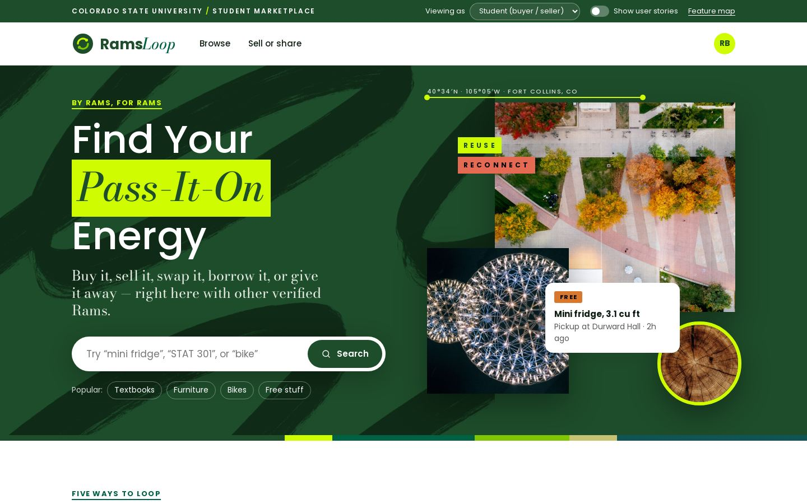
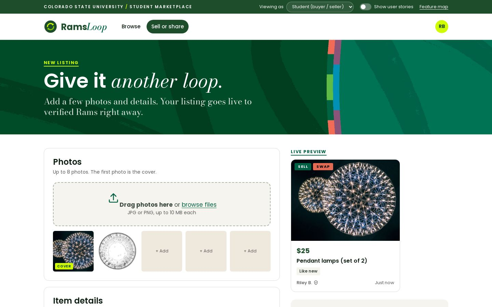
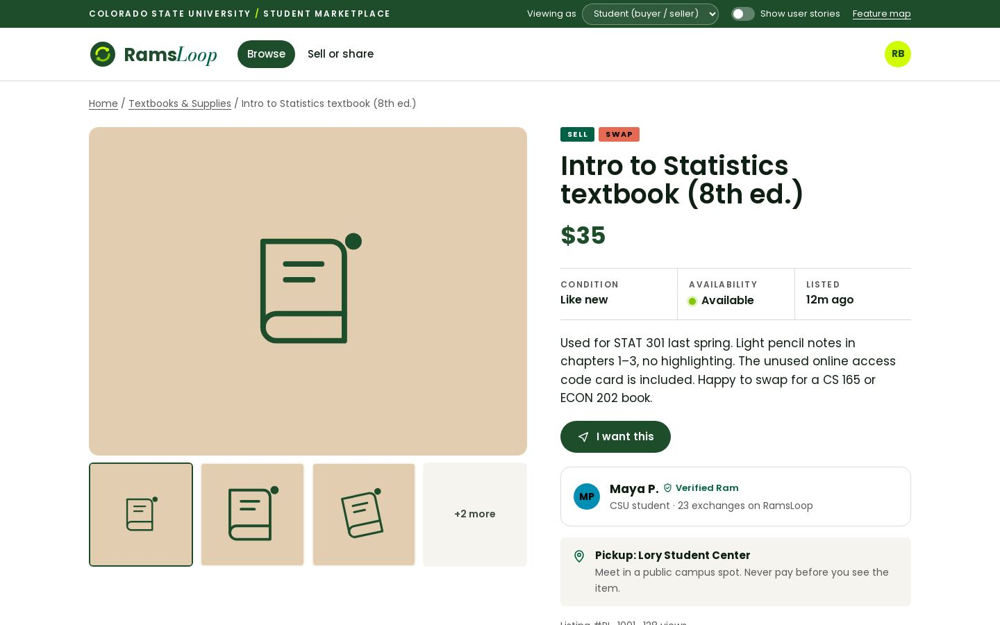
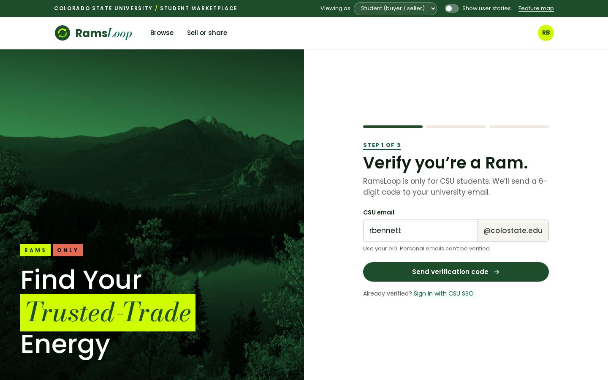
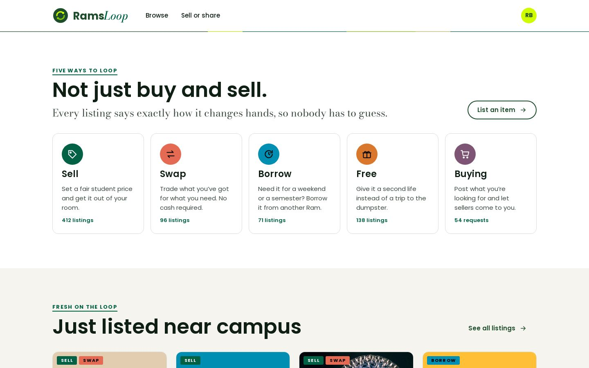
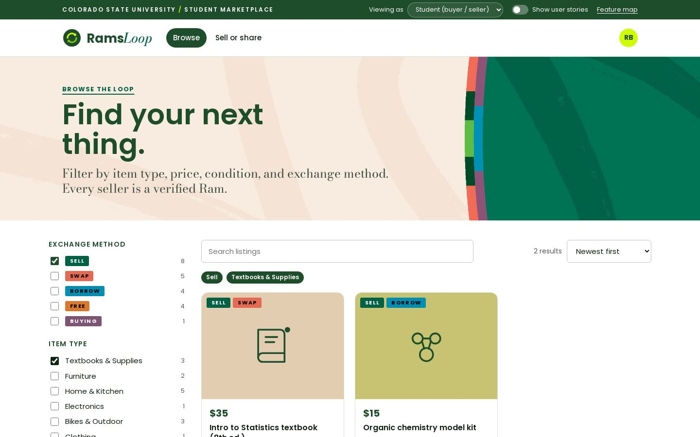
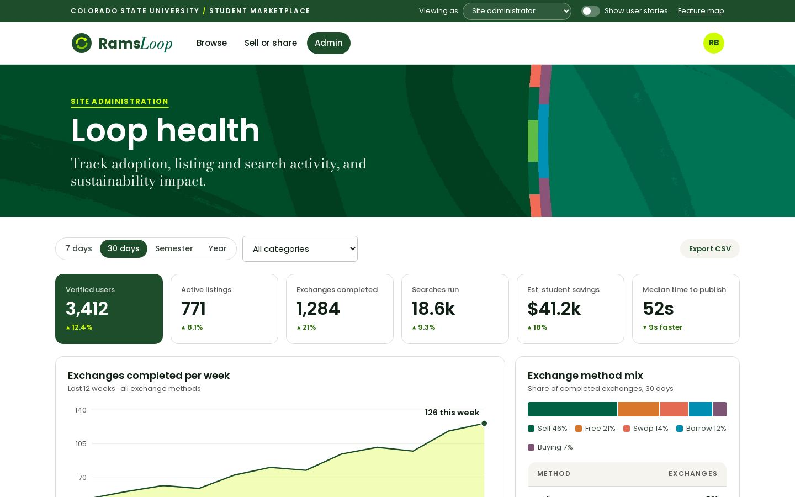
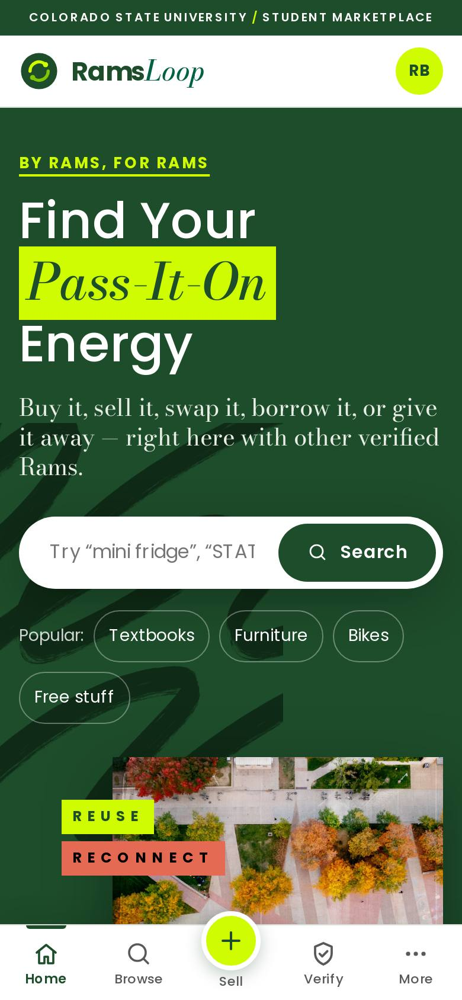
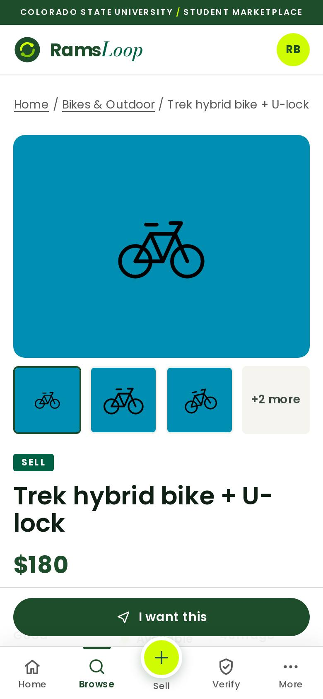
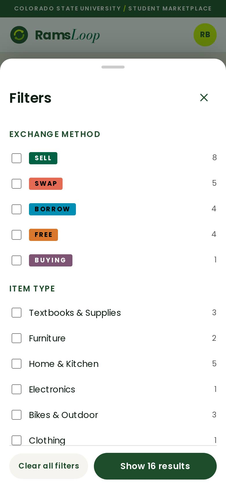

<p align="center">
  
</p>

<h1 align="center">RamsLoop</h1>

<p align="center">
  <strong>Buy, sell, swap, borrow, or give it away, with other verified Rams.</strong><br>
  A clickable UI mockup of a student-only marketplace for Colorado State University.<br>
  CIS 675 · Project Proposal, Team 1
</p>

<p align="center">
  <a href="https://jwelch00.github.io/Ramsloop/"><strong>Open the live demo →</strong></a>
  &nbsp;·&nbsp;
  <a href="https://jwelch00.github.io/Ramsloop/#/stories">Feature map</a>
  &nbsp;·&nbsp;
  <a href="https://github.com/jwelch00/Ramsloop/tree/full-version">Original 17-story draft</a>
</p>



## What it is

RamsLoop is a campus marketplace where only people with a CSU email can get in.
Every listing says exactly how the item changes hands: **sell, swap, borrow, free,** or **buying** (a request).

This repo is a front-end mockup, built to show the screens and flows from our proposal.
It runs entirely in the browser on sample data. There is no backend, so nothing you type is saved or sent anywhere.

## The user stories

The mockup covers the twelve highest-priority stories from the proposal: six from Sprint 1 and six added in Sprint 2.

| Priority | Sprint | Story | Theme | As a… | Where to see it |
|:-:|:-:|---|---|---|---|
| 1 | 1 | **US 9** · Create and publish listing | Listing & Exchange Management | Seller: create and publish a listing with photos, a description, condition, price, and exchange method so buyers can discover and evaluate my item. | [Sell or share](https://jwelch00.github.io/Ramsloop/#/sell) |
| 2 | 1 | **US 6** · Item details | Listing & Exchange Management | Buyer: view item photos, descriptions, conditions, price, and availability so I can make an informed decision. | [Listing detail](https://jwelch00.github.io/Ramsloop/#/item/1) |
| 3 | 1 | **US 1** · CSU affiliation verification | Trusted CSU Community | User: verify my CSU affiliation with my university email so I can use a trusted, student-only marketplace. | [Verify account](https://jwelch00.github.io/Ramsloop/#/verify) |
| 4 | 1 | **US 11** · Select exchange method | Listing & Exchange Management | User: mark a listing as buy, sell, swap, borrow, or free so other users understand the proposed exchange. | Sell form, plus the tags on every listing |
| 5 | 1 | **US 5** · Search and filter listings | Item Discovery | Buyer: search and filter listings by item type, price, condition, and exchange method so I can find suitable items quickly. | [Browse](https://jwelch00.github.io/Ramsloop/#/browse) |
| 6 | 1 | **US 17** · Site performance dashboard | Platform Administration | Site administrator: access performance indicators to monitor the health of the site. | [Admin dashboard](https://jwelch00.github.io/Ramsloop/#/admin) |
| 7 | 2 | **US 13** · Private messaging | Communication & Community Engagement | User: send and receive messages within RamsLoop so I can coordinate an exchange without sharing my personal contact information. | [Messages](https://jwelch00.github.io/Ramsloop/#/messages) |
| 8 | 2 | **US 10** · Edit, pause, or remove listings | Listing & Exchange Management | Seller: edit, pause, or remove my listing so the item's information and availability stay accurate. | [My listings](https://jwelch00.github.io/Ramsloop/#/my/listings) |
| 9 | 2 | **US 3** · Report users or listings | Trusted CSU Community | User: report suspicious users or listings so administrators can investigate safety concerns. | Report link on [listings](https://jwelch00.github.io/Ramsloop/#/item/19), profiles, and messages |
| 10 | 2 | **US 4** · Marketplace moderation | Trusted CSU Community | Moderator: review reports and remove fraudulent, inactive, or prohibited listings so RamsLoop stays trusted and safe. | [Moderator console](https://jwelch00.github.io/Ramsloop/#/moderation) |
| 11 | 2 | **US 2** · Ratings and reviews | Trusted CSU Community | User: view another user's ratings and reviews from previous exchanges before exchanging with them. | [Seller profile](https://jwelch00.github.io/Ramsloop/#/profile/maya) |
| 12 | 2 | **US 8** · Favorites list | Item Discovery | User: save listings to a favorites list so I can review items I'm interested in later. | [Favorites](https://jwelch00.github.io/Ramsloop/#/my/saved) |

## Sprint 2

Sprint 2 adds the next six stories by priority. The [feature map](https://jwelch00.github.io/Ramsloop/#/stories) lists each one's story points, impact, and acceptance criteria.

- **Messages (US 13):** text messages with up to 4 photos (JPG or PNG, 10 MB each), a 1,000-character limit with a counter, and no blank messages. Each sent message shows how long delivery took. Phone numbers and emails never appear on the page, and typing one shows a reminder that you don't need to share it. The inbox stays newest first, with unread badges and search. You can report or block someone from the conversation, and blocked users can't send you new messages. A demo switch makes the next message fail so you can see the "Try again" button, which resends without retyping.
- **My listings (US 10):** edit price, description, condition, photos, and exchange method. The listing ID and seller are locked. Missing or invalid fields show an error right away. Pause and reactivate take one click, and removing a listing asks you to confirm first. Paused and removed listings disappear from search immediately, and removed listings can't be edited or reactivated. Only the seller sees these controls.
- **Report (US 3):** report a listing, a seller profile, or someone in a conversation. Listings and profiles each have their own set list of reasons, and picking one is required. You can add up to 300 words (with a live word count) and screenshots. The confirmation shows the case number, and the report goes straight into the moderator queue. You can only report the same listing or person once; trying again shows a notice instead. A demo switch makes the report fail so you can see the error, and canceling discards it.
- **Moderation (US 4):** switch *Viewing as* to *Moderator* to review reports. Filter the queue by type and reason, and sort it by date or severity. Each report links to the listing or profile and shows the reporter's details and attachments. Removing a listing (from the console or right on the listing page) requires a removal reason. It takes the listing out of search and everyone's favorites, and the seller is emailed the reason. Dismissing a report archives it. Every action goes through a dialog you can back out of, and it's written to the **Audit log** tab with a timestamp and moderator ID. Students who open the console are sent back to Home.
- **Ratings and reviews (US 2):** seller profiles show the average rating, the star breakdown, and reviews from completed exchanges. New users with no exchanges get a caution note instead.
- **Favorites (US 8):** tap the heart on any listing. The Favorites tab shows photo, title, price, condition, and exchange method, along with a running count against the 100-listing limit. Favorites are private to you, and listings that stop being available are removed automatically.

Acceptance criteria for US 2 are still being written, so that screen follows the user story text.

## Screenshots

<table>
  <tr>
    <td width="50%"><br><sub><b>US 9</b> · Create and publish a listing, with a live preview of the card</sub></td>
    <td width="50%"><br><sub><b>US 6</b> · Photos, description, condition, price, and availability</sub></td>
  </tr>
  <tr>
    <td><br><sub><b>US 1</b> · Verify with a @colostate.edu email and a 6-digit code</sub></td>
    <td><br><sub><b>US 11</b> · Five exchange methods, tagged on every listing</sub></td>
  </tr>
  <tr>
    <td><br><sub><b>US 5</b> · Filter by exchange method, item type, price, and condition</sub></td>
    <td><br><sub><b>US 17</b> · Performance indicators for site administrators</sub></td>
  </tr>
</table>

It also works on phones, with a bottom tab bar and slide-up filters:

<p align="center">
  
  &nbsp;
  
  &nbsp;
  
</p>

## Demo tips

- **Show user stories:** flip the switch in the top bar. A yellow tag appears beside each feature with the story it covers.
- **Viewing as:** switch to *Moderator* for the **Moderation** tab and the remove button on listings (US 4), or *Site administrator* for the **Admin** tab (US 17).
- **Feature map:** the link in the top bar lists all twelve stories and jumps to each screen.

## Run it yourself

Click **Code → Download ZIP**, unzip it, and open `index.html` in any browser. That's all it needs.

Or, from a terminal in the project folder:

```bash
python3 -m http.server 8000
```

Then go to <http://localhost:8000>.

## What's in here

```
index.html       every screen (one page; the URL after # picks the screen)
css/styles.css   all styling, including the phone layout
js/app.js        sample data, search and filters, messaging, listing management,
                 favorites, reports, moderation, page switching, admin charts
assets/          fonts, photos, and textures
docs/            logo and the screenshots on this page
```

## Full version

The first version of the mockup covered all 17 stories from the proposal, including alerts, borrowing terms, the community board, and events, which haven't been brought into this version yet.
It's saved under the [`full-version`](https://github.com/jwelch00/Ramsloop/tree/full-version) tag.

## Credits

- Fonts: [Poppins](https://github.com/itfoundry/Poppins) and [Bodoni Moda](https://github.com/indestructible-type/Bodoni), both under the SIL Open Font License (license files are in `assets/fonts/`).
- This is a student project for coursework. It is not an official Colorado State University website.
